  

  <a href="https://github.com/dev-sabaree">GitHub</a>
  &nbsp;·&nbsp;
  <a href="https://dev-sabaree.vercel.app/">Portfolio</a>
  &nbsp;·&nbsp;
  <a href="https://github.com/dev-sabaree?tab=repositories">Projects</a>

## About me

I'm **Sabareesh K.**, a developer focused on building practical, well-structured software. I work across Flutter applications, backend integrations, and AI-assisted product ideas, with a particular interest in clean architecture and useful developer tools.

I completed a Diploma in Computer Engineering and am currently pursuing a B.Tech in Computer Science and Engineering (2025–2028).

## Current focus

- Building Flutter experiences with clear architecture and dependable API integration.
- Exploring backend systems and AI-powered application workflows.
- Improving the maintainability of projects through clean, intentional implementation.

## Featured projects

### [Newsilo](https://github.com/dev-sabaree/news)

A Flutter news application that brings authenticated discovery, search, offline caching, and multilingual support into one mobile experience.

`Flutter` · `Dart` · `BLoC` · `Supabase` · `NewsAPI`

[View repository →](https://github.com/dev-sabaree/news)

### [Package Inspection AI](https://github.com/dev-sabaree/package-inspection-ai)

An AI-powered packaging-defect inspection project built around a Flutter client, FastAPI, and a custom YOLO model.

`Flutter` · `FastAPI` · `Python` · `YOLO`

[View repository →](https://github.com/dev-sabaree/package-inspection-ai)

### [WeSecure](https://github.com/dev-sabaree/wesecure)

An AI-assisted website-security analysis and learning application with customizable prompts and result history.

`TypeScript` · `React` · `Vite` · `Google GenAI`

[View repository →](https://github.com/dev-sabaree/wesecure)

## Technology stack

| Area | Technologies represented in public work |
| :-- | :-- |
| Languages | `Dart` · `Python` · `TypeScript` · `JavaScript` · `PHP` |
| Mobile development | `Flutter` · `BLoC` |
| Backend & APIs | `FastAPI` · `REST APIs` · `NewsAPI` · `Google GenAI` |
| Data & services | `Supabase` · `Firebase` |
| Developer tools & platforms | `Git` · `GitHub` · `Linux` · `Vite` |

## GitHub activity

My public activity, repositories, and contributions live on [GitHub](https://github.com/dev-sabaree?tab=overview). I keep this profile free of third-party statistic widgets so it remains reliable and focused.

## Connect

- [GitHub](https://github.com/dev-sabaree)
- [Portfolio](https://dev-sabaree.vercel.app/)

  

